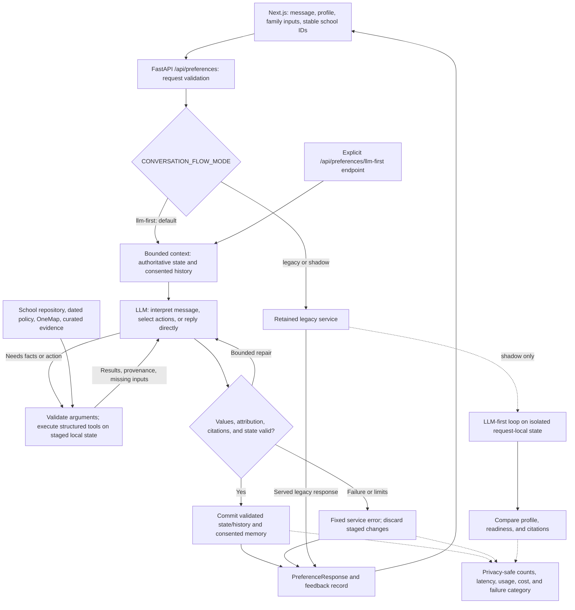

# KinderCompass — Current Implementation

This document is the consolidated implementation reference for KinderCompass. It describes the current data pipeline, application architecture,
conversation flow, recommendation stages, evidence model, retrieval services,
API, configuration, and verification workflow.

It reflects the repository as of 25 October 2026. Runtime code under
`SystemCode/src/` remains authoritative when this document and the
implementation differ.

Primary references:

- [Repository setup and user guide](../README.md)
- [Backend documentation index](../SystemCode/src/backend/doc/README.md)
- [Backend API guide](../SystemCode/src/backend/README.md)
- [Offline data pipeline](../SystemCode/src/scripts/README.md)
- [Knowledge graph schema](../SystemCode/src/scripts/KNOWLEDGE_GRAPH_SCHEMA.md)

## 1. Architecture and boundaries

```text
ECDA and location data
        |
        v
prepare_data.py --> kindercompass_master.json --> build_knowledge_graph.py
        |                                                |
        |                                                v
        +---------------------------------------------> Neo4j
                                                         |
Next.js frontend --> FastAPI --> services --> Stage 1 search and ranking
                         |             |----> Stage 2 eligibility and fees
                         |             `----> Stage 3 distance
                         |
                         +--> LLM-first conversation and structured tools
                         +--> parent-guide retrieval
                         `--> school-isolated official-webpage retrieval
```

The Next.js frontend communicates only with FastAPI. FastAPI reloads
authoritative school, policy, fee, and location data rather than trusting
browser-supplied school records.

The LLM may interpret language, select bounded tools, and word grounded
responses. It does not:

- construct or execute arbitrary Neo4j queries;
- change the validated preference schema;
- calculate ranking, eligibility, subsidies, fees, or distance;
- override deterministic exclusions; or
- use webpage or parent-guide evidence to change ranking.

Deterministic fallbacks remain available around optional LLM capabilities.

### 1.1 Agent request lifecycle



The loop permits zero-tool greetings and clarifications as well as dependent,
combined requests. Default per-turn limits are eight model calls, twelve tool
calls, four repair calls, 30 seconds, 128,000 context bytes, and 16,000 model
output bytes. Repairs share those limits.

Validated turns make one state/history commit and, when consented, one memory
write. Failed turns discard staged changes and do not fall back to the legacy
flow. Shadow execution adds observation latency but does not write shared
history, preference memory, or answer feedback. Routine telemetry records
counts, elapsed time, usage, estimated cost, and fixed failure categories
without raw conversations, family details, profiles, or tool contents.

See the [rollout contract](../SystemCode/src/backend/doc/llm-first-rollout.md),
[HTTP integration](../SystemCode/src/backend/doc/llm-first-http.md), and
[agent progress record](../SystemCode/src/backend/doc/agents.md) for the
detailed runtime contracts and evaluation history.

## 2. Data preparation and identifiers

Raw data is stored under `SystemCode/data/raw/`. The offline pipeline produces
`SystemCode/data/processed/kindercompass_master.json`, which is required when
the backend starts. The catalogue combines school identity, location, services,
programme fees, licence information, evidence metadata, and coverage flags.

Prepare the catalogue and load Neo4j from the repository root:

```powershell
.\.venv\Scripts\python.exe -m SystemCode.src.scripts.prepare_data
.\.venv\Scripts\python.exe -m SystemCode.src.scripts.build_knowledge_graph
```

Graph updates are non-destructive unless the explicit rebuild option is used.
Rerun both commands after replacing raw data or changing preparation or graph
mapping logic. The destructive option is `build_knowledge_graph
--clear-existing`; review the offline pipeline guide before using it.

Every API handoff uses a stable `school_id`:

- `CENTRE:<centre_code>` when a centre code is available;
- `TP:<tp_code>` for records identified by TP code.

Bare centre codes are source identifiers, not the complete application ID.
Missing location, fee, licence, or vacancy enrichment remains visible as
unavailable evidence rather than causing the school to be silently discarded.

## 3. Application and conversation flow

The UI contains **Form**, **Results**, and **Map** tabs beside **Compass chat**.
The normal flow is:

1. Enter and save the family details and home postal code.
2. State preferences over one or more chat turns.
3. Review the cumulative structured profile under **Understood preferences**.
4. Select **Show recommendations** to run Stage 1 search and Stage 2 evaluation.
5. Review eligible schools, programme estimates, evidence, and distance.
6. Select schools for map and comparison questions.

The family form collects:

- child date of birth and intended admission date;
- citizenship and preferred care programme;
- gross household income and applicant working hours;
- household size and non-earning dependants;
- potential ECDA Special Approval circumstances; and
- a six-digit home postal code.

The form does not ask for a basic subsidy amount. Stage 2 derives applicable
subsidies from dated policy data.

### 3.1 Conversation rollout

`POST /api/preferences` uses `CONVERSATION_FLOW_MODE`:

- `llm-first` — default; the LLM-first loop uses validated structured tools;
- `shadow` — serves the legacy response while observing the LLM-first path;
- `legacy` — serves the retained deterministic/agent controller.

`POST /api/preferences/llm-first` is the explicit evaluation endpoint.
`CONVERSATION_AGENT_MODE` applies to the retained legacy supervisor and is
separate from the HTTP rollout. It defaults to `agent`; set it to
`deterministic` when the legacy flow must avoid agent behavior. An invalid
`CONVERSATION_FLOW_MODE` fails visibly with HTTP 503 rather than silently
selecting another flow.

Pure preference-update turns do not search. **Show recommendations** calls
`POST /api/search`, which retrieves candidates from Neo4j. The LLM-first chat
may independently invoke bounded school-search tools before that button is
used; those tools filter the generated JSON catalogue and call the same shared
scorer rather than querying Neo4j.

### 3.2 Conversation memory

With consent enabled:

- recent messages are retained in process-local memory for 30 minutes of
  inactivity;
- the bounded context holds at most six exchanges and 8,000 characters;
- the structured preference profile is stored in SQLite for up to 180 days;
- raw chat, family details, postal codes, and selected schools are excluded from
  the persistent profile.

After a browser refresh, structured preferences and unresolved contradictions
can be restored. Previous chat messages are not restored to the visible panel.

## 4. Preference contract

The source of truth is
[`preference_schema.py`](../SystemCode/src/backend/pipeline/stage1/preference_schema.py).
The current schema version is 2.

A profile retains compatibility fields (`hard_constraints` and `preferences`)
and canonical `preference_items`. Each item contains:

- `attribute` and validated `value`;
- `importance`;
- extraction `confidence`;
- `evidence_class`;
- mapped `school_property`; and
- an evidence warning when applicable.

Importance has four levels:

- `required`;
- `high_priority`;
- `preferred`;
- `nice_to_have`.

Evidence classes are:

- `supported` — directly represented by catalogue data;
- `partially_supported` — represented with material limitations;
- `unsupported` — retained for conversation but excluded from ranking.

Supported or partially supported attributes include care level, language,
SPARK status, transport, full-day operation, operator scheme, food policy,
pedagogy, and maximum distance.

The current catalogue cannot rank hands-on learning, child-led learning,
worksheet use, primary-school readiness, or atmosphere. These requests remain
visible with warnings.

Allowed pedagogy values are Montessori, Play-based, Bilingual, and Reggio
Emilia. Pedagogy is inferred from the centre name and is sparse; a generic or
missing value is treated as unknown. A no-pork statement does not establish
halal sourcing or certification.

Legacy extraction can report `llm`, `rules`, or `rules_fallback`. Fallback
reasons contain only a safe exception type and never credentials or raw
provider errors.

## 5. Stage 1 — candidate retrieval and ranking

Stage 1 converts the profile into validated filters, applies location and
required-preference rules, then ranks the remaining schools. There are two
retrieval entry points:

- **Show recommendations** and `POST /api/search` retrieve candidates from
  Neo4j before applying the shared scorer.
- In-chat school-search tools filter
  `SystemCode/data/processed/kindercompass_master.json` and then apply the same
  scorer.

Hard filters include care level, required language, and maximum distance where
applicable. With a saved home postal code but no explicit distance preference,
**Show recommendations** applies a default 5 km straight-line radius. The
in-chat near-home search defaults to 1 km. An explicit positive limit,
including decimal values such as 1.5 km, overrides the relevant default and may
cross planning-area boundaries. Planning-area filtering is used only when no
radius applies, such as an island-wide distance opt-out or unavailable postal
location.

A verified failure of a supported `required` preference excludes a school.
Unknown evidence is not a failure and does not by itself exclude the school.

### 5.1 Evidence-aware scoring

Each scored preference starts with its configured base weight and an importance
multiplier:

```text
required       2.0
high_priority  1.5
preferred      1.0
nice_to_have   0.5
```

Only verified, current evidence earns match credit. Unknown, stale,
future-dated, inferred, and partially supported evidence does not establish a
confirmed match or mismatch. Derived pedagogy evidence may contribute partial
evidence completeness but does not receive match credit.

The three parent-facing measures are:

```text
match_score        = verified weighted matches / verifiable weighted evidence
profile_confidence = usable evidence weight / requested preference weight
combined_score     = sqrt(match_score * profile_confidence * 100)
```

`match_score` is a percentage and `profile_confidence` is stored from 0 to 1.
The combined score is the geometric mean of match percentage and evidence
completeness percentage.

Schools are sorted by:

1. `combined_score` descending;
2. `match_score` descending;
3. `profile_confidence` descending;
4. `school_id` ascending.

Cost and distance provide comparison context but do not increase ranking.
Selected-school chat comparisons use the same score-first principle and never
substitute cost or distance as hidden ranking tie-breakers.

## 6. Stage 2 — eligibility and estimated fees

Stage 2 uses the Stage 1 shortlist, family details, the school's nested service
menu, and dated policy resources.

For each school it:

1. computes the child's completed age in months on the admission date;
2. maps age to the eligible care level;
3. confirms that the school offers the level;
4. selects a matching monthly programme fee for level, citizenship, and
   programme type;
5. derives Basic Subsidy from programme and working status;
6. evaluates the applicable income or per-capita-income band;
7. caps Additional Subsidy by the policy maximum and minimum co-payment; and
8. returns an estimated amount payable with warnings and policy provenance.

The estimate follows the policy constraints rather than a simple unrestricted
`fee - subsidies` subtraction:

```text
additional applied = min(maximum additional, fee - basic - minimum co-payment)
estimated payable  = max(minimum co-payment, fee - basic - additional applied)
```

Possible outcomes include `estimated`, `ineligible`, `fee_unavailable`, and
`manual_review`. Special Approval, Flexi Care 2, and policy cases requiring
human assessment do not fabricate an approved subsidy. Non-Singapore-Citizen
fees may be shown where available, but Singapore Citizen subsidies are not
applied.

All figures are indicative. Families must confirm current fees, GST, additional
charges, programme availability, and subsidy eligibility with the preschool
and ECDA.

## 7. Stage 3 — home distance

OneMap resolves the home postal code. Preschool coordinates come from the
prepared catalogue and location data.

Distances are independent Haversine straight-line measurements from the same
home point to each selected preschool. They are not road distance, route
distance, public-transport distance, or travel time.

- `POST /api/distances` calculates a batch of home-to-school distances.
- `POST /api/route` retains the single-school Stage 3 handoff.
- Batch distance results omit schools without usable coordinates, allowing the
  UI to report distance as unavailable. The single-school `/api/route` endpoint
  returns HTTP 422 when its required location cannot be attached.

## 8. Evidence, provenance, and explanations

Each preference entry in `match_breakdown` can include:

- `evidence_state`: verified, derived, calculated, partially supported, or
  unknown;
- `value_state`: confirmed yes, confirmed no, confirmed value, inferred value,
  calculated value, partially supported value, recorded value, or unknown;
- source and source method;
- source reliability and date; and
- freshness: current, stale, future-dated, or unknown.

Evidence completeness reports how much weighted preference evidence is usable.
It does not certify that a source is correct or current. Missing evidence is
shown as unavailable rather than interpreted as a negative answer.

The system supports grounded questions about ranking, provenance, reliability,
missing evidence, exclusions, trade-offs, hypothetical changes, closest
schools, and selected-school comparisons. Deterministic calculations remain
authoritative even when an LLM words the explanation.

Run the evidence audit with:

```powershell
$env:PYTHONPATH = "SystemCode/src/backend;SystemCode/src/backend/pipeline"
.\.venv\Scripts\python.exe SystemCode\src\backend\scripts\audit_evidence_quality.py
```

## 9. Retrieval services

KinderCompass has three distinct evidence paths. None changes ranking.

### 9.1 Structured application evidence

Recommendation explanations use the validated profile, shortlist, eligibility,
fees, distance, selected schools, and trace metadata. Optional LLM wording is
bounded to this supplied context; deterministic templates are the fallback.

### 9.2 Parent guidance

General parent questions use a separate curated or local vector retrieval path.
`GENERAL_KNOWLEDGE_RETRIEVAL_MODE` defaults to `curated`; supported modes are
`curated`, `lexical`, and `vector`.

The default curated mode reads
`SystemCode/src/backend/resources/web_rag/general_knowledge_index.json`.
Lexical and vector modes use the built parent-guide index under
`SystemCode/data/vectors/parent_guide/`, overridable with
`GENERAL_KNOWLEDGE_VECTOR_PATH`. General guidance is kept separate from
school-specific evidence.

### 9.3 Official-webpage evidence

Official-webpage retrieval is isolated to the selected school or its reviewed
operator page. It provides citations for explanation and does not alter
suitability, ranking, fees, eligibility, or distance.

The default index is
`SystemCode/src/backend/output/web_rag_pilot_index.json`; use
`WEB_RAG_INDEX_PATH` to override it. `WEB_RAG_ANSWER_MODE` supports
`deterministic` and `agent`.

The committed
[`web_rag_readiness.json`](../SystemCode/src/backend/output/web_rag_readiness.json)
is the authoritative snapshot for the current pilot. It reports:

- `production_ready: false`;
- identity accuracy `0.90`, below the `0.95` gate;
- retrieval accuracy `0.9016`;
- citation completeness, scope accuracy, and school isolation `1.0`;
- 18 indexed school pages and 7 indexed operator pages.

The pilot may be used for development explanations, but the production identity
gate has not passed. Re-run the readiness audit after changing inventory,
review decisions, fetched pages, or index construction.

## 10. HTTP API

Request and response contracts are defined in
[`domain/models.py`](../SystemCode/src/backend/domain/models.py).

| Method | Endpoint | Purpose |
|---|---|---|
| GET | `/api/health` | Liveness |
| POST | `/api/preferences` | Conversation and cumulative profile |
| POST | `/api/preferences/llm-first` | Explicit LLM-first evaluation |
| POST | `/api/search` | Stage 1 search and ranking |
| POST | `/api/evaluate` | Stage 2 eligibility and fees |
| POST | `/api/geocode` | Resolve a postal code |
| POST | `/api/distances` | Batch straight-line distances |
| POST | `/api/route` | Single-school Stage 3 distance |
| POST | `/api/schools/{school_id}/programme-estimate` | Recalculate a programme estimate |
| POST/GET | `/api/schools/{school_id}/ratings` | Anonymous school ratings |
| POST | `/api/memory/save` | Save structured preferences |
| POST | `/api/memory/restore` | Restore structured preferences |
| POST | `/api/memory/forget` | Forget saved memory and history |
| POST | `/api/memory/preferences/forget` | Forget persistent preferences |
| POST | `/api/conversation/forget` | Forget process-local history |
| POST | `/api/chat-feedback` | Record answer usefulness |
| GET | `/api/chat-feedback/summary` | Summarise answer feedback |
| POST | `/api/feedback` | Record recommendation feedback |

## 11. Configuration and launch

The [root README](../README.md#section-5--project-setup) is the canonical
setup guide.

Required for the default flow:

- `NEO4J_URI`, `NEO4J_USERNAME`, and `NEO4J_PASSWORD`;
- OneMap email/password or `ONEMAP_TOKEN`;
- `OPENAI_API_KEY`.

Important optional settings include:

- `NEO4J_DATABASE`;
- `CONVERSATION_FLOW_MODE`;
- `CONVERSATION_AGENT_MODE`;
- `GENERAL_KNOWLEDGE_RETRIEVAL_MODE`;
- `WEB_RAG_ANSWER_MODE` and `WEB_RAG_INDEX_PATH`;
- `OPENAI_PREFERENCE_EXTRACTION_ENABLED`;
- `OPENAI_INTENT_CLASSIFICATION_ENABLED`;
- `OPENAI_GROUNDED_EXPLANATIONS_ENABLED`;
- `OPENAI_WEB_RAG_ANSWERS_ENABLED`;
- model and timeout settings for each OpenAI capability.

Create `SystemCode/src/frontend/.env.local` with the public backend URL only:

```dotenv
NEXT_PUBLIC_API_URL=http://127.0.0.1:8000
```

Start both services:

```powershell
.\run_poc1.ps1 -InstallDependencies
.\run_poc1.ps1
```

The launcher installs the backend runtime requirements and frontend packages.
Install the root `requirements.txt` separately when the complete data,
evaluation, and notebook environment is required. Because the repository does
not currently include `.env.local.example`, create `.env.local` manually before
running the launcher; otherwise its copy step cannot complete.

The frontend runs at `http://localhost:3000`; FastAPI runs at
`http://127.0.0.1:8000`, with interactive documentation at `/docs`.

## 12. Verification and evaluation

Run the backend regression suite:

```powershell
$env:PYTHONPATH = "SystemCode/src/backend;SystemCode/src/backend/pipeline"
.\.venv\Scripts\python.exe -m unittest discover -s SystemCode/src/backend/tests -v
```

Validate the offline pipeline and frontend build:

```powershell
.\.venv\Scripts\python.exe -m unittest discover -s SystemCode/src/scripts/tests -v
npm --prefix SystemCode/src/frontend run build
```

Focused implementation audits and evaluations are under
`SystemCode/src/backend/scripts/`:

- `audit_preference_coverage.py`;
- `audit_evidence_quality.py`;
- `evaluate_recommendations.py`;
- `evaluate_stage1_graph.py`;
- `evaluate_llm_first_conversation.py`;
- `evaluate_conversation_supervisor.py`;
- `evaluate_parent_guide.py`;
- `evaluate_recommendation_judge.py`;
- `evaluate_web_rag_pilot.py`;
- `evaluate_web_rag_answers.py`; and
- `audit_web_rag_readiness.py`.

The [RAGAS toolkit](../SystemCode/src/backend/evaluation/ragas/README.md)
contains the evidence-answer datasets, capture tools, scorer, baselines, and
offline regression tests. Run its provider-free checks with `make eval-check`.

Generated evaluation results are snapshots. Compare results only when catalogue,
configuration, model, and run identifiers match.

## 13. Current limitations

- Eligibility and subsidy results use dated proof-of-concept policy resources,
  not live ECDA decisions.
- Fee estimates may exclude GST, deposits, registration fees, and other centre
  charges.
- Distance is straight-line only and is unavailable for schools without usable
  coordinates.
- Stage 1 depends on the prepared catalogue and expected Neo4j schema.
- Pedagogy, food policy, and other partially supported preferences require
  parent verification.
- Unsupported qualitative preferences remain conversational context and cannot
  affect ranking.
- LLM output is bounded by structured tools and evidence but can still fail or
  require deterministic fallback.
- Parent-guide and webpage evidence are explanation-only.
- The committed webpage-RAG pilot does not satisfy its production identity
  gate.
- Structured preferences can persist with consent, but visible chat messages do
  not return after refresh.

## 14. Maintenance rule

Update this document whenever a change affects:

- the default conversation rollout;
- preference attributes, importance, or scoring;
- Stage 2 policy logic or family inputs;
- Stage 3 distance semantics;
- public API endpoints;
- retrieval modes or production-readiness gates; or
- setup, launch, and validation commands.

Keep historical implementation narratives in version control history rather
than adding phase-specific Markdown files back into this directory.
